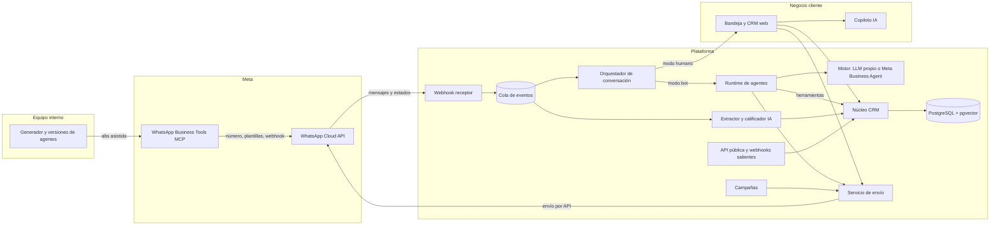
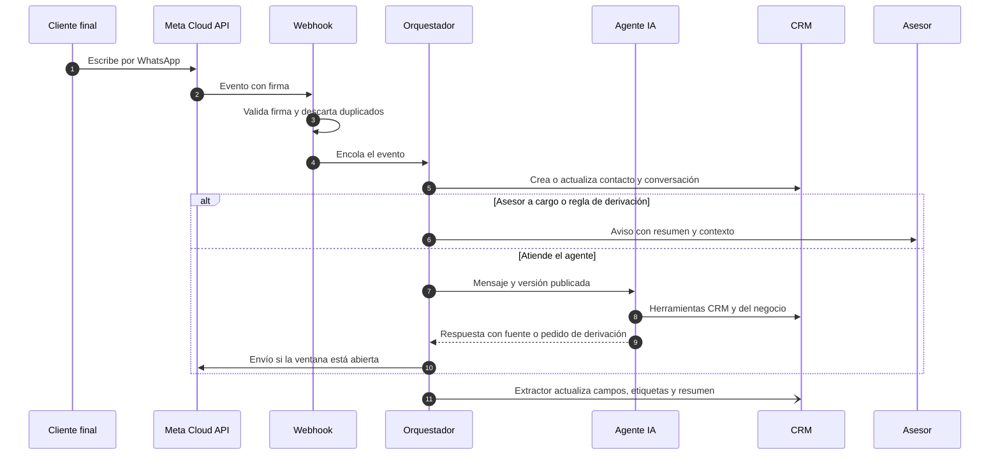

> **Cómo leer este spec.** Define qué producto construir, con qué arquitectura y en qué orden. **No autoriza construir.** Cada fase del Anexo E se construye con su propio spec aprobado. Una sesión de Claude Code que lo lea debe empezar por la sección 10 (preguntas abiertas) y el Anexo E (fases), y respetar las decisiones de la sección 9.
>
> **Actualización del 16-oct-2026.** El MVP a construir está definido en **SPEC-2026-10-16-02** (`specs/SPEC-2026-10-16-02-mvp-crm-agente-respuesta.md`). Este spec queda como **visión de producto**: da contexto, pero no es vinculante. La instrucción anterior para sesiones de Claude Code queda sin efecto: la referencia de construcción es SPEC-02 (ver `AGENTS.md`). Antes de usar un dato de este documento, revisa las erratas que siguen.

## Erratas (revisión del 16-oct-2026)

Salen de revisar este spec desde cinco enfoques y de una segunda verificación técnica. El detalle está en `docs/analisis/revision-2026-10-16.md`. El texto original no se modificó: estas correcciones prevalecen sobre él.

| # | Dónde | Corrección |
| --- | --- | --- |
| E1 | §1 restricción 3, Anexo F | Falta el tramo gratuito: cada número tiene **1.000 mensajes de servicio gratis al mes** (unos 33 por día) desde el 1-oct-2026. Sin método de pago, Meta deja de entregar al agotarse. Las plantillas utility no usan ese tramo. Los mensajes de Meta Business Agent no usan el tramo ni la ventana gratuita del punto de entrada, así que el ahorro de "aprovechar la ventana gratuita" (Anexo F) no aplica con ese motor. Esa ventana es de 72 h según la documentación consultada, pero hay reportes de una extensión a 7 días desde el 28-sep-2026; confirmar |
| E2 | §1 restricción 4, D9 | En el mismo ejemplo de Meta (tarifas de Brasil), una IA propia de baja complejidad cuesta unos 2-3 centavos por mensaje, menos que Meta Business Agent (4-5). Meta Business Agent excluye finanzas, gobierno, salud, alcohol, apuestas, medicamentos de venta libre y servicios matrimoniales, y opera con traspaso del control del hilo. No se verificó su disponibilidad en Perú |
| E3 | §1 restricción 5, P4 | Según Meta, la coexistencia permite **20 mensajes por segundo**, no 5. Sincroniza 180 días de historial, pero la media solo de los últimos 14. Se activa con Embedded Signup (Tech Provider); no hay evidencia de que el MCP la soporte. Embedded Signup v2 y v3 quedaron obsoletos el 15-oct-2026: corresponde usar v4 |
| E4 | D13, Anexo C (Mensaje) | El `pricing` del webhook de estado trae `pricing_model`, `type` y `category`. `billable` está anunciado como obsoleto. Hay más categorías que las cuatro listadas, y cualquier estado (sent, delivered o read) puede traer el `pricing`. Hay que guardar el objeto completo. `subtype` y la forma en que se marca el tramo gratuito no están verificados |
| E5 | Anexo B (webhook receptor), Anexo C (EventoEntrante) | Deduplicar por `wamid` descarta los estados, porque sent, delivered y read comparten el `wamid` del mensaje saliente. Meta no envía un `id_evento` global. Ver la idempotencia de SPEC-02 D9 |
| E6 | 4.3 (Costo), D12, Anexo B (servicio de envío), Anexo F | Bloquear o pasar a "solo humano" por presupuesto no detiene el cobro de Meta, porque los mensajes de los asesores también se cobran. Lo correcto: el tope de IA desactiva el bot y el presupuesto de Meta solo genera alertas; nunca se bloquea la respuesta a un cliente que escribió |
| E7 | Anexo B (diagramas) | El envío tiene que pasar por el servicio de envío (D12), no ir directo a Meta. El extractor se dispara al cerrar la conversación, no con cada evento de la cola |
| E8 | Anexo C (introducción, que contradice D11) | `organizacion_id` va en **todas** las entidades, incluidas las de la propuesta, no solo en las nuevas. Otros problemas: `FuenteConocimiento`, colgada del agente, rompe D3; las plantillas pertenecen a la WABA, no a la versión; `Herramienta` necesita una tabla intermedia con la versión; Pipeline y Etapa son dos tablas. Faltan Usuario, Membresia, CuentaWhatsApp (WABA), Adjunto, Horario, Cola y un registro por turno (TurnoAgente y LlamadaLLM) |
| E9 | Anexo C (Contacto) | En 2026 Meta está desplegando identificadores de usuario por negocio (BSUID) y nombres de usuario, y el teléfono puede no llegar. La clave (organizacion_id, wa_id) puede no bastar |
| E10 | §3 | El spec no extiende la propuesta "sin contradecirla": la modifica en campañas, Embedded Signup, motor del agente y uso de la plataforma por el negocio. La propuesta ya preveía una bandeja para los asesores del negocio |
| E11 | Anexo A | La v3.8.18, los ~2.000 usuarios y los 21 idiomas salen de la captura del 16-oct. El límite de 250 y la v1.3.3 de mayo-junio salen de extscope. Nada de esto se pudo volver a verificar: el último registro indexado es la v2.4.1 del 29-jun-2026, con ~1.000 usuarios, lo que contradice el párrafo "Ritmo". Otras fuentes recomiendan 900 o entre 20 y 50 envíos diarios. El benchmark de mercado relevante son las plataformas sobre la API oficial (Kommo, Leadsales, respond.io, Callbell, Wati, B2Chat); ver `docs/analisis/` |
| E12 | D1, M1, Anexo E (F1) | El MCP solo actúa sobre los portafolios a los que tiene acceso la persona autenticada: no sirve para dar de alta números de otros negocios a escala. Para eso hay que ser Tech Provider (verificación del negocio, App Review y acceso avanzado) y usar Embedded Signup v4. Una integración directa dentro del portafolio de un solo piloto no requiere App Review. Ver SPEC-02 D2 y P1 |

## 1. Contexto

**Qué existe.** El 14-oct-2026 Omar Jesus Yañez Carlos publicó en el repo `oyanezc99/wsp-chatbot-mcp` la propuesta *"Módulo de configuración de agentes para WhatsApp"* (único archivo del repo, commit "Propuesta Generada"). Tiene dos piezas: un **módulo interno** con el que el equipo genera un agente de IA por negocio cliente a partir de un brief y lo conecta a WhatsApp con el MCP oficial de Meta (WhatsApp Business Tools MCP), y un **runtime** que atiende en vivo a los clientes finales: los mensajes entran por webhook y las respuestas salen por la WhatsApp Cloud API. El MCP se usa solo en el alta.

**Qué se quiere.** Que el producto sea un **CRM + automatización de respuestas con agentes IA**. El negocio cliente no solo recibe un bot: gestiona en la plataforma a sus contactos, oportunidades de venta, seguimientos y campañas, y los agentes escriben en ese CRM lo que aprenden de cada conversación. La referencia de mercado es **Wapes**, una extensión de Chrome que convierte WhatsApp Web en un "CRM" (análisis en el Anexo A).

**Qué le falta a la propuesta para ser un CRM.** Ya trae bandeja de asesores, roles, auditoría y métricas básicas. No trae ficha de contacto con historial, etiquetas, campos propios, pipeline de ventas, tareas, importación y exportación, ni API pública. Además deja las campañas masivas fuera de la v1.

**Restricciones del entorno (verificadas al 16-oct-2026)**

1. **Política de Meta** (dato de la propuesta): desde el 15-ene-2026 la API de WhatsApp Business prohíbe los chatbots de IA de propósito general y permite los de atención, ventas y notificaciones de una empresa.
2. **Cobro por mensaje:** desde el 1-jul-2025 Meta cobra por mensaje entregado según la categoría de la plantilla (marketing, utility, autenticación) y el país de destino. Perú tiene tarifa propia y, desde el 1-abr-2026, se puede facturar en soles (PEN).
3. **Cambio vigente desde el 1-oct-2026:** los mensajes de servicio, es decir, las respuestas libres dentro de la ventana de 24 h, **se cobran por mensaje entregado**, a la tarifa utility/autenticación del mercado y sin descuento por volumen. Da igual si los escribe una persona o una IA propia. Las plantillas utility enviadas dentro de la ventana también se cobran. Solo siguen gratis los mensajes dentro de la ventana de entrada gratuita de 72 h, que se abre cuando el cliente llega desde un anuncio Click to WhatsApp o un botón de Facebook. **Consecuencia: cada respuesta del agente cuesta tarifa de Meta + costo del LLM.**
4. **Meta Business Agent:** desde el 1-jul-2026 Meta ofrece su propia plataforma de agentes de IA para negocios, conectable por API, y desde el 1-ago-2026 la cobra por tokens: USD 2 por millón, con un solo cargo que incluye la entrega. Meta estima 4–5 centavos por mensaje típico; en su ejemplo para Brasil, un agente con IA propia de complejidad alta sale en 9–10 centavos por mensaje (ambas cifras son estimaciones de Meta). Es a la vez competidor y posible motor del producto (P3, D9).
5. **Coexistencia:** un número que hoy usa la app WhatsApp Business puede conectarse a la Cloud API sin dejar la app. Sincroniza contactos y hasta 6 meses de historial y refleja los mensajes en ambos lados. No sincroniza grupos, deja las listas de difusión de la app en solo lectura y limita a 5 mensajes por segundo. Fuente: proveedor Chakra; validar con Meta (P4).
6. **Riesgo de lo no oficial:** en octubre de 2025 Socket reportó 131 extensiones de Chrome que inyectan código en WhatsApp Web para envíos masivos y programados, saltándose los controles antispam. Su uso puede terminar en el bloqueo de la cuenta y puede exponer los mensajes a terceros (Malwarebytes). Wapes usa el mismo mecanismo de inyección: eso no la hace parte de esa campaña, pero comparte el riesgo.

**Estado del repositorio central.** Esta sesión no tuvo acceso a la computadora: no se leyó `INDEX.md`. En Drive no había specs previos. Se usa el ID `SPEC-2026-10-16-01`; al sincronizar, verificar que no choque con otro spec del mismo día.

**Revisión.** Este spec se revisa en conjunto entre Manuel y Omar antes de aprobarse.

## 2. Inputs

| # | Insumo | Ubicación | Uso |
| --- | --- | --- | --- |
| 1 | Propuesta "Módulo de configuración de agentes para WhatsApp" (Omar, 14-oct-2026) | `github.com/oyanezc99/wsp-chatbot-mcp` → `Propuesta Módulo de configuración de agentes para WhatsApp.md` | Base de arquitectura, modelo de datos, seguridad y fases |
| 2 | Ficha de Wapes en Chrome Web Store (v3.8.18, 14-oct-2026) | `chromewebstore.google.com/detail/ockelnmgipmhmcjedaekchaodpdegneb` | Benchmark funcional |
| 3 | Análisis técnico de Wapes (permisos, dominios, límite en código, historial de versiones) | `extscope.org/extension/ockelnmgipmhmcjedaekchaodpdegneb` | Arquitectura y riesgos de Wapes |
| 4 | Captura de la ficha de Wapes compartida por Manuel | Chat del 16-oct-2026 | Contexto |
| 5 | Precios de la plataforma de WhatsApp y cambios para mensajes sin plantilla | `developers.facebook.com` (ver Fuentes) | Restricciones 2–4 y modelo de costos |
| 6 | Guía de coexistencia (Chakra) | Ver Fuentes | Restricción 5 y P4 |
| 7 | Reporte de extensiones spam en WhatsApp Web (Malwarebytes / Socket) | Ver Fuentes | Restricción 6 y D6 |
| — | **Faltante:** `INDEX.md` y specs del repositorio central local | `C:\Users\Manuel\Documents\SDD-Specs` | Revisar al sincronizar (tarea 9) |

## 3. Objetivo

Que Manuel y Omar aprueben una especificación funcional y técnica de una plataforma multi-negocio de **CRM + agentes IA sobre la API oficial de WhatsApp**, que extienda la propuesta del repo sin contradecirla y que alcance para escribir los specs de construcción de cada fase.

## 4. Alcance

### 4.1 Módulos del producto

M1, M2 y M12 vienen de la propuesta (con ajustes); M3 a M11 son la capa CRM nueva.

| Módulo | Qué hace | Origen | Fase |
| --- | --- | --- | --- |
| **M1. Alta y conexión** | Brief, generación del agente, alta del número, plantillas, webhook y mensaje de prueba vía MCP de Meta. Evaluar coexistencia para negocios que ya usan la app (P4) | Propuesta | F1–F2 |
| **M2. Agentes de atención** | Versiones inmutables, base de conocimiento con fuente (RAG), acciones, reglas de derivación, horarios y límites obligatorios. Motor intercambiable: LLM propio o Meta Business Agent (D9) | Propuesta + D9 | F2–F4 |
| **M3. Bandeja de conversaciones** | Chats en tiempo real; filtros (sin asignar, míos, en bot, en espera); asignación; tomar y devolver el control entre bot y humano; notas internas; adjuntos; indicador de ventana de 24 h y de ventana gratuita de 72 h | Propuesta (bandeja) + Wapes (todo dentro del chat) | F3 |
| **M4. Copiloto IA del asesor** | Resumen del chat, respuesta sugerida, reescritura del borrador y respuesta en el idioma del cliente, con cuota por plan | Wapes (asistente IA) | F3 |
| **M5. Respuestas rápidas** | Respuestas guardadas con variables (`{{nombre}}`), categorías, búsqueda y atajo `/`; compartidas por equipo; la IA puede proponerlas | Wapes | F3 |
| **M6. Contactos (núcleo CRM)** | Ficha única por número: datos, campos propios, etiquetas, consentimiento, origen, asesor dueño y línea de tiempo (mensajes, notas, tareas, oportunidades, cambios). Deduplicación por número. Importación CSV/Excel con mapeo de columnas. Exportación CSV/Excel/vCard con permiso y auditoría | Nuevo (Wapes solo exporta) | F3 |
| **M7. Extracción y calificación IA** | Al cerrar una conversación (o en hitos) extrae datos estructurados (nombre, correo, interés, producto, presupuesto, intención), aplica etiquetas, propone etapa y temperatura del cliente potencial (frío, tibio, caliente) y escribe un resumen en la línea de tiempo. Con confianza baja deja sugerencias, no cambios | Nuevo | F4 |
| **M8. Oportunidades (pipeline)** | Tablero por etapas configurables; cada oportunidad se liga a un contacto y una conversación, con monto, producto, fecha estimada y motivo de pérdida | Nuevo | F4 |
| **M9. Tareas y seguimientos** | Tareas con fecha y responsable, ligadas a contacto u oportunidad. El agente crea tareas a partir de compromisos detectados en el chat ("te escribo el lunes"). Aviso al asesor al vencer; recordatorio al cliente solo con plantilla aprobada si la ventana cerró | Nuevo | F4 |
| **M10. Campañas** | Envío a segmentos con plantilla aprobada y opt-in vigente: variables, programación, envío escalonado, tope de presupuesto, prueba en seco, reporte por destinatario (enviado, entregado, leído, respondido, fallido, baja) y procesamiento automático de bajas | Wapes (envíos masivos), rehecho sobre la API oficial | F5 (sujeto a P1) |
| **M11. Reportes y costos** | Conversaciones, tiempo de primera respuesta (bot y humano), resolución por bot, tasa de derivación, temas, conversión por etapa, desempeño por asesor, campañas. Costo por negocio: Meta por categoría + LLM por función, contra presupuesto | Propuesta (panel) + nuevo | F4–F5 |
| **M12. Integraciones y administración** | API REST pública y webhooks salientes (contacto creado, etapa cambiada, conversación derivada, tarea vencida). Organizaciones, usuarios, roles (equipo interno, administrador, supervisor, asesor), permisos por módulo, auditoría, doble factor, retención y enmascarado | Propuesta (seguridad) + nuevo (API) | F1 (base) a F5 (API) |

### 4.2 Agentes IA del producto

| Agente | Quién lo usa | Qué hace | Cuándo corre |
| --- | --- | --- | --- |
| Generador | Equipo interno | Convierte el brief en la configuración del agente (propuesta) | En el alta |
| Atención | Cliente final | Responde con fuente, ejecuta acciones, deriva | En cada mensaje entrante si la conversación está en modo bot |
| Copiloto | Asesor | Resume, sugiere y reescribe | A pedido del asesor |
| Extractor y calificador | CRM | Llena campos, etiquetas, temperatura, etapa sugerida y resumen | En segundo plano: al cerrar la conversación o cada N mensajes |

Todos escriben en el CRM con las mismas herramientas (Anexo D) y quedan en auditoría.

### 4.3 Requisitos no funcionales (metas propuestas, a validar)

- **Latencia:** el cliente final recibe la respuesta del agente en 10 s o menos en el 95 % de los casos.
- **Idempotencia:** un mismo evento de Meta procesado dos veces no duplica mensajes ni registros.
- **Aislamiento:** ningún usuario ve datos de otra organización; se prueba de forma automática.
- **Trazabilidad:** cada respuesta del agente guarda versión, fuentes usadas y herramientas llamadas.
- **Costo:** alerta al 80 % del presupuesto mensual del negocio; al 100 %, la conversación pasa a modo solo humano.
- **Privacidad:** enmascarado de DNI, tarjetas y teléfonos antes del LLM (propuesta); cifrado en tránsito y en reposo; retención configurable.

### 4.4 Pantallas principales (para el diseño y la generación de la app)

1. **Bandeja:** lista de chats, chat activo y panel lateral con ficha del contacto, oportunidad abierta y copiloto.
2. **Contactos:** tabla con filtros, segmentos guardados, importación y exportación.
3. **Ficha del contacto:** datos, etiquetas, consentimiento, línea de tiempo, oportunidades y tareas.
4. **Pipeline:** tablero por etapas con arrastrar y soltar.
5. **Tareas:** mis tareas, vencidas y del equipo.
6. **Campañas:** asistente (plantilla → segmento → prueba en seco → programación) y reporte.
7. **Reportes:** operación, ventas y costos.
8. **Configuración del negocio:** usuarios y roles, horarios, etiquetas, campos, pipelines, respuestas rápidas, presupuesto, API y webhooks.
9. **Módulo interno** (propuesta): briefs, agentes y versiones, alta vía MCP, registro de operaciones MCP.

## 5. Fuera de alcance

- Automatizar WhatsApp Web (extensiones, inyección de código o librerías no oficiales), ni para enviar ni para leer.
- Extraer contactos de grupos de WhatsApp.
- Enviar mensajes a contactos sin opt-in o a listas compradas.
- Bots de propósito general (prohibidos por Meta desde 2026).
- De la propuesta: llamadas de voz y video, canales distintos de WhatsApp, entrenamiento o ajuste fino de modelos, integraciones a medida con sistemas del cliente y una integración propia con la API de Meta para el alta (revisar si P4 lo exige).
- App móvil nativa en la v1: la bandeja es web y se adapta al celular.
- Facturación y cobro automático a los negocios en la v1.
- Escribir código: este spec define; la construcción va en specs por fase.

## 6. Plan

| Paso | Qué | Costo | Checkpoint |
| --- | --- | --- | --- |
| 1 | Revisión conjunta del spec (Manuel + Omar); responder P1, P2, P8 | Bajo | ✋ **Aprobar alcance**: el spec pasa a `aprobado` o vuelve a `borrador` |
| 2 | Validaciones externas: acceso al MCP y coexistencia (P4), rate card PEN, disponibilidad de Meta Business Agent en Perú, negocio piloto (P9) | Bajo | — |
| 3 | Modelo de costos por conversación: LLM propio vs Meta Business Agent (Anexo F) | Medio | Insumo para P3 y P8 |
| 4 | ADRs: stack y nube, cola, motor de agente y LLM, aislamiento multi-negocio, herramientas como MCP propio (skill `engineering:architecture`) | Medio | — |
| 5 | Diseño detallado: modelo de datos consolidado, contratos de API y eventos, pantallas (skill `engineering:system-design`) | Medio | ✋ **Aprobar diseño** |
| 6 | Specs de construcción por fase, empezando por F1–F3 | Bajo cada uno | ✋ **Aprobar cada spec antes de construir** |
| 7 | Construcción por fase con Claude Code en el repo | Alto | Fuera de este spec |

## 7. Tareas

| # | Tarea | Costo | Salida |
| --- | --- | --- | --- |
| 1 | Revisar el spec con Omar y registrar acuerdos y cambios | Bajo | Fila en la Bitácora + respuestas a P1, P2 y P8 |
| 2 | Confirmar acceso al WhatsApp Business Tools MCP y si el alta permite coexistencia | Bajo | Nota en `analisis/` |
| 3 | Obtener el rate card PEN vigente desde el 1-oct-2026 (servicio, utility, marketing, autenticación) | Bajo | Tabla de tarifas en `analisis/` |
| 4 | Definir negocio piloto, casos de uso y volumen esperado | Bajo | Ficha del piloto |
| 5 | Construir el modelo de costos (Anexo F), incluido Meta Business Agent | Medio | `analisis/modelo-costos.md` u hoja de cálculo |
| 6 | Redactar ADR-01 a ADR-05 (stack y nube, cola, motor y LLM, multi-negocio, herramientas como MCP) | Medio | `adr/` |
| 7 | Consolidar modelo de datos (propuesta + Anexo C) y contratos de API y eventos | Medio | `analisis/diseno-detallado.md` |
| 8 | Escribir los specs de construcción de F1, F2 y F3 | Bajo | 3 specs en `borrador` |
| 9 | Sincronizar este spec al repositorio central y actualizar `INDEX.md` | Bajo | `proyectos/wsp-chatbot-mcp/specs/SPEC-2026-10-16-01-crm-agentes-ia-whatsapp.md` |

## 8. Artefactos

- Este spec, que pasa a `ejecutado` al cumplir los criterios de la sección 11.
- `analisis/benchmark-wapes.md` (se puede extraer del Anexo A al sincronizar).
- `analisis/modelo-costos.md` u hoja de cálculo equivalente.
- `adr/ADR-01` a `adr/ADR-05`.
- `analisis/diseno-detallado.md`.
- Specs de construcción por fase en `specs/`.

## 9. Decisiones

**Heredadas de la propuesta (vigentes)**

- **D1.** El MCP de Meta se usa solo en el alta (número, plantillas, webhook, prueba). La operación diaria va por webhook + Cloud API con token de usuario de sistema. *Razón:* Meta lo define para desarrollo y pruebas, y cada cambio de estado exige una persona autenticada.
- **D2.** PostgreSQL con pgvector, sin base vectorial aparte en la v1. *Razón:* una sola base que operar.
- **D3.** La versión del agente es inmutable y cada conversación guarda con qué versión se atendió. *Razón:* historial fiel y vuelta atrás.
- **D4.** El agente está acotado al negocio con límites obligatorios que el generador no puede quitar. *Razón:* política de Meta 2026 y riesgo de respuestas inventadas.
- **D5.** Enmascarado de datos personales antes del LLM y cumplimiento de la Ley N.° 29733. *Razón:* protección de datos.

**Propuestas por este spec (se cierran al aprobar)**

- **D6.** Solo API oficial de WhatsApp; no se construye nada sobre WhatsApp Web como hace Wapes. *Razón:* riesgo de bloqueo del número, sin atención 24 h ni webhooks, y datos del negocio en el navegador del asesor.
- **D7.** El contacto es la entidad central del CRM: la conversación cuelga del contacto (`Conversacion.contacto_id` reemplaza a `cliente_wa_id`). *Razón:* una persona tiene varias conversaciones, oportunidades y tareas a lo largo del tiempo.
- **D8.** Los agentes escriben en el CRM solo mediante herramientas con esquema, habilitadas por versión de agente y registradas en auditoría; con confianza baja dejan sugerencias. *Razón:* trazabilidad y control; extiende las "Acciones" de la propuesta.
- **D9.** El motor del agente es intercambiable detrás de una interfaz: LLM propio o Meta Business Agent, elegible por negocio. *Razón:* desde octubre de 2026 cada respuesta paga tarifa de Meta, y Meta estima que su agente puede salir más barato por mensaje; la elección final depende del modelo de costos (P3).
- **D10.** Las funciones IA tipo Wapes (resumen, sugerencia, reescritura) corren en el servidor, con enmascarado y cuota por plan. *Razón:* las llaves del LLM no salen del servidor y el costo queda controlado.
- **D11.** Multi-negocio desde el modelo: todo registro lleva `organizacion_id`; el mecanismo de aislamiento se fija en un ADR. *Razón:* la propuesta ya tiene `Organizacion` con plan; separar después cuesta más.
- **D12.** Todo envío sale por un único servicio de envío que verifica ventana de 24 h, ventana gratuita de 72 h, opt-in y presupuesto antes de llamar a la Cloud API. *Razón:* cumplimiento y costo en un solo punto.
- **D13.** Cada mensaje guarda la categoría de cobro que Meta informa en el webhook de estado (`service`, `utility`, `marketing`, `authentication`) y un costo estimado. *Razón:* costo por negocio y conciliación con la factura de Meta.
- **D14.** En la v1, monolito modular (identidad, conversaciones, agentes, CRM, campañas, integraciones, reportes) más procesos en segundo plano para webhook, agentes, extracción y campañas, conectados por una cola. *Razón:* equipo de dos personas, menos piezas que desplegar; los módulos se pueden separar después.

## 10. Preguntas abiertas

| # | Pregunta | Se resuelve en |
| --- | --- | --- |
| P1 | ¿Las campañas entran al producto? La propuesta las deja fuera de la v1 y este spec las ubica en F5. Decidir si entran, en qué fase y con qué límites | Paso 1 |
| P2 | ¿Quién usa la plataforma del lado del negocio? La propuesta dice que el negocio no usa el módulo interno; este spec asume que sus asesores y supervisores sí usan la bandeja y el CRM. Confirmar si el servicio es gestionado por el equipo, de autoservicio o mixto | Paso 1 |
| P3 | Motor del agente: ¿LLM propio, Meta Business Agent o ambos según el negocio? Depende del costo y de lo que permita la API de Meta Business Agent (herramientas, RAG, derivación) | Pasos 3 y 4 |
| P4 | ¿El alta vía MCP permite coexistencia para negocios que ya usan la app WhatsApp Business? Si no, ¿se acepta Embedded Signup aunque la propuesta excluye una integración propia para el alta? | Paso 2 |
| P5 | Stack: la propuesta sugiere ASP.NET Core + PostgreSQL/pgvector + Angular o React. Falta elegir front, cola, nube y región de los datos | Paso 4 |
| P6 | Proveedor y modelo de LLM por función (atención, copiloto, extracción, generación) y presupuesto mensual por negocio (pendiente de la propuesta) | Paso 4 |
| P7 | ¿Las herramientas CRM del agente se publican también como servidor MCP propio, para que el equipo opere el CRM desde Claude o Claude Code con los mismos permisos? | Paso 4 |
| P8 | Precio al negocio: ¿por asesor, por conversaciones atendidas o costo de Meta trasladado más margen? ¿Plan gratis con cuota de IA como Wapes? | Pasos 1 y 3 |
| P9 | Negocio piloto y casos de uso del primer agente: soporte, ventas o citas (pendiente de la propuesta) | Paso 2 |
| P10 | Retención por tipo de dato y transferencia de datos fuera del Perú (Ley N.° 29733) | Paso 4 |
| P11 | Meta de calidad del extractor (por ejemplo, 80 % de oportunidades con producto y datos de contacto sin edición manual) y cómo se mide | Paso 5 |

## 11. Criterios de aceptación

- [ ] Omar revisó el spec; acuerdos y cambios registrados en la Bitácora.
- [ ] P1, P2, P3, P4 y P9 resueltas con decisión escrita.
- [ ] Rate card PEN obtenido y costo por conversación calculado para el piloto, con LLM propio y con Meta Business Agent.
- [ ] ADR-01 a ADR-05 creados en `adr/`.
- [ ] Modelo de datos consolidado, sin entidades duplicadas entre la propuesta y el Anexo C.
- [ ] Specs de construcción de F1, F2 y F3 creados en estado `borrador`.
- [ ] Ninguna funcionalidad del alcance depende de automatizar WhatsApp Web.
- [ ] Spec sincronizado en el repositorio central local, sin `pendiente_sync_local` y con su fila en `INDEX.md`.

## Anexo A — Wapes como CRM

**Qué es.** Extensión de Chrome (Manifest V3) que se inserta en la interfaz de WhatsApp Web. Según su ficha en Chrome Web Store al 16-oct-2026: versión 3.8.18 (actualizada el 14-oct-2026), unos 2.000 usuarios, calificación 4,9, sitio `wapes.lat`, desarrollador independiente. Tiene compras dentro de la extensión; la ficha no publica precios.

**Ritmo.** En el registro de extscope de mayo–junio de 2026 figuraba como versión 1.3.3, con unos 1.000 usuarios y solo en español latinoamericano; hoy figura en 21 idiomas. Duplicó usuarios en unos cuatro meses: hay demanda en Latinoamérica de IA y gestión de clientes dentro de WhatsApp para vendedores pequeños.

**Funciones según su ficha**

| Función | Qué hace | Plan |
| --- | --- | --- |
| Asistente IA | Resumen del chat, respuesta sugerida y reescritura del borrador, en el idioma de cada chat | Gratis con créditos diarios; PRO con más uso |
| Respuestas rápidas | Respuestas guardadas con variables como `{{name}}`, categorías, búsqueda y atajos `/`; la IA puede proponerlas | 5 en el plan gratis, 30 en los pagos |
| Exportación de chats | A HTML con medios reproducibles o a CSV; se elige qué incluir | Resumen IA dentro de la exportación solo en PRO |
| Envíos masivos | Contactos desde CSV o Excel, campos dinámicos, adjuntos, plantillas reutilizables, prueba en seco y reporte de entregas | — |
| Herramientas de grupos | Exporta los contactos de un grupo a CSV, Excel o vCard | — |
| Protección de cuenta | Retrasos aleatorios y límite diario de envíos (el código incluye un límite diario de 250, según extscope) | — |
| Interfaz | Integrada al diseño de WhatsApp Web, sin ventanas flotantes | — |

**Cómo funciona por dentro.** Permisos `storage` y `tabs`; acceso a `web.whatsapp.com`, a `api.wapes.lat` (su backend; la extensión pide iniciar sesión con correo y contraseña) y a `api2.amplitude.com` (servicio de analítica), según extscope. La ficha declara que maneja datos de identificación personal, de autenticación, actividad del usuario y contenido del sitio. El desarrollador afirma que no guarda mensajes ni listas de contactos y que la IA solo procesa el chat que el usuario elige.

Consecuencias de ese diseño:

- Solo funciona con WhatsApp Web abierto en el navegador de una persona: no hay atención 24 h ni respuestas automáticas sin alguien conectado.
- No hay servidor que reciba mensajes: sin webhooks, sin API pública y sin conectores (búsqueda del 16-oct-2026).
- Es una herramienta para una persona, no para un equipo: no hay asignación, roles ni bandeja compartida.

**Evaluación como CRM**

| Capacidad de un CRM | Wapes | Comentario |
| --- | --- | --- |
| Ficha de contacto con historial | No | El historial vive dentro de WhatsApp |
| Etiquetas, campos propios, segmentos | No figuran en la ficha | Depende de las etiquetas del propio WhatsApp |
| Pipeline de ventas | No | — |
| Tareas, recordatorios, notas | No | — |
| Equipo: asignación, roles, bandeja compartida | No | Una sesión por navegador |
| Reportes comerciales | Parcial | Solo reporte de entregas de los envíos masivos |
| Integraciones (API, webhooks) | No | — |
| IA | Sí, como asistente de la persona | No responde sola |
| Cumplimiento con Meta | Débil | Automatiza WhatsApp Web; riesgo de bloqueo |

**Conclusión.** Wapes no es un CRM: es un kit de productividad y envíos para un vendedor que atiende desde WhatsApp Web. Su valor está en cuatro cosas: IA que ayuda a responder, respuestas rápidas, mover contactos dentro y fuera de WhatsApp, y envíos masivos baratos. Nuestro producto cubre esas cuatro necesidades sobre la API oficial y suma lo que Wapes no puede ofrecer por su arquitectura: agentes que atienden solos las 24 h, equipo con roles, datos de CRM en servidor e integraciones.

**Necesidad por necesidad**

| Necesidad del vendedor | Cómo la resuelve Wapes | Cómo la resolvemos |
| --- | --- | --- |
| Responder rápido y bien | Asistente IA dentro de WhatsApp Web | Copiloto en la bandeja (M4) + agente que responde solo (M2) |
| No reescribir lo mismo | Respuestas rápidas con variables y `/` | Igual, y compartidas por equipo (M5) |
| Llevar contactos dentro y fuera | Exportar chats y grupos; importar CSV/Excel | Importación y exportación con permisos (M6) + API (M12); sin extraer grupos |
| Escribir a muchos a la vez | Envíos masivos con retrasos aleatorios y límite diario para reducir el riesgo de bloqueo | Campañas con plantillas aprobadas, opt-in y presupuesto (M10) |
| Saber qué pasó | Reporte de entregas | Reportes comerciales y de costo (M11) |
| Seguir cada venta | — | Contactos, pipeline y tareas (M6, M8, M9) |
| Atender fuera de horario | — | Agente 24 h con derivación y mensaje fuera de horario (M2) |

**Argumento comercial frente a herramientas como Wapes:** el número del negocio no corre riesgo de bloqueo por automatización no autorizada, los chats no pasan por una extensión de terceros con acceso al contenido del sitio, y el sistema no se rompe cada vez que cambia WhatsApp Web.

## Anexo B — Arquitectura propuesta

Se mantienen los dos momentos de la propuesta (alta y conversación) y se agregan los componentes del CRM.

| Componente | Responsabilidad |
| --- | --- |
| Webhook receptor | Valida la firma `X-Hub-Signature-256` (propuesta), descarta duplicados por `wamid`, guarda el evento crudo, lo encola y responde 200 de inmediato |
| Cola de eventos | Separa recepción de procesamiento; reintentos con espera creciente y cola de errores. Tecnología en ADR |
| Orquestador de conversación | Crea o actualiza contacto y conversación, aplica los tres filtros de la propuesta (¿asesor a cargo?, ¿regla de derivación?, ¿respuesta con sustento?) y enruta a bot o humano |
| Runtime de agentes | Carga la versión publicada, arma el contexto (base de conocimiento + ficha del contacto), llama al motor y ejecuta herramientas |
| Servicio de envío | Único punto de salida a la Cloud API: verifica ventanas, opt-in, presupuesto y tipo de mensaje; registra la categoría de cobro (D12, D13) |
| Núcleo CRM | Contactos, campos, etiquetas, consentimientos, oportunidades, tareas, notas y línea de tiempo |
| Extractor y calificador | Proceso en segundo plano que escribe en el CRM con las mismas herramientas de los agentes (D8) |
| Bandeja y CRM web | Interfaz de asesores y supervisores, con actualización en tiempo real (WebSocket o SignalR) |
| Copiloto | Servicios de resumen, sugerencia y reescritura en el servidor (D10) |
| Campañas | Programador, evaluación del segmento y envío escalonado a través del servicio de envío |
| API pública y webhooks salientes | Contratos versionados; suscripciones firmadas con secreto propio |
| Datos y operación | PostgreSQL + pgvector; almacenamiento de objetos para medios y documentos; gestor de secretos; logs, trazas por conversación, métricas de costo y latencia, alertas de presupuesto |

**Flujo de un mensaje entrante**

## Anexo C — Modelo de datos: extensión CRM

Se conserva el modelo de la propuesta. Todas las entidades nuevas llevan `organizacion_id` (D11). Claves únicas: `Contacto (organizacion_id, wa_id)` y `Mensaje (wamid)`.

**Cambios a entidades de la propuesta**

| Entidad | Cambio | Razón |
| --- | --- | --- |
| Conversacion | `cliente_wa_id` pasa a `contacto_id`; agrega `oportunidad_id` (opcional), `resumen_ia`, `ventana_abierta_hasta`, `ventana_gratuita_hasta` | D7 y D12 |
| Mensaje | Agrega `tipo` (libre / plantilla), `categoria_cobro`, `costo_estimado`, `estado_entrega` | D13 |
| Herramienta | Agrega `ambito` (del negocio / CRM interna) | Anexo D |
| Organizacion | Agrega `moneda`, `presupuesto_mensual_meta`, `presupuesto_mensual_ia`, `cuota_copiloto` | Control de costos |

**Entidades nuevas**

| Entidad | Campos clave | Relación |
| --- | --- | --- |
| Contacto | id, wa_id, telefono_e164, nombre, correo, origen (orgánico / anuncio / importación / campaña), asesor_dueno_id, temperatura, puntaje, ultimo_mensaje_en | Tiene muchas conversaciones, oportunidades, tareas y notas |
| CampoPersonalizado | id, nombre, tipo (texto / número / fecha / lista), opciones | Definido por organización |
| ValorCampo | contacto_id, campo_id, valor, origen (asesor / agente / importación), confianza | — |
| Etiqueta | id, nombre, color | — |
| ContactoEtiqueta | contacto_id, etiqueta_id, origen, fecha | — |
| Consentimiento | contacto_id, tipo (marketing / utilidad), estado (opt-in / opt-out), origen, evidencia, fecha | Lo consulta el servicio de envío |
| Segmento | id, nombre, filtro (JSON) | Se evalúa al usarse |
| Pipeline y Etapa | id, nombre, orden, probabilidad | Configurables por organización |
| Oportunidad | id, contacto_id, conversacion_id, etapa_id, monto, moneda, producto, fecha_estimada, estado (abierta / ganada / perdida), motivo_perdida, asesor_id, creada_por | — |
| Tarea | id, contacto_id, oportunidad_id, asignado_id, titulo, vence_en, estado, origen (asesor / agente) | — |
| Nota | id, contacto_id, conversacion_id, autor_id, texto | Interna; nunca se envía al cliente |
| ActividadContacto | id, contacto_id, tipo, referencia_id, resumen, fecha | Alimenta la línea de tiempo |
| RespuestaRapida | id, atajo, categoria, texto con variables, adjunto | — |
| Campana | id, plantilla_id, segmento_id, programada_en, ritmo_por_minuto, presupuesto_max, estado | — |
| EnvioCampana | campana_id, contacto_id, wamid, estado, costo_estimado, fecha | Reporte por destinatario |
| ConsumoIA | id, funcion (atención / copiloto / extracción / generación), version_id, tokens_entrada, tokens_salida, costo_estimado, fecha | Costo del LLM por negocio |
| EventoEntrante | id_evento, wamid, hash, recibido_en, procesado_en, estado | Idempotencia y reproceso |
| SuscripcionWebhook | id, url, eventos, secreto, estado | Webhooks salientes |

## Anexo D — Herramientas CRM de los agentes

**Reglas**

- Solo actúan sobre el contacto de la conversación en curso.
- Se habilitan por versión de agente, igual que las acciones de la propuesta.
- Cada llamada queda en `Auditoria` con la versión del agente y la conversación.
- Un agente nunca exporta ni lista contactos, nunca envía campañas, nunca borra datos y nunca cierra oportunidades (ganada o perdida): eso lo confirma una persona en la v1.
- Las herramientas CRM no piden confirmación al cliente final; las acciones del negocio mantienen el campo `requiere_confirmacion` de la propuesta.

| Herramienta | Qué hace |
| --- | --- |
| `obtener_ficha` | Lee datos, etiquetas y oportunidades abiertas del contacto actual |
| `actualizar_contacto` | Escribe nombre, correo o campos propios; con confianza baja deja una sugerencia |
| `etiquetar` | Agrega o quita etiquetas permitidas por la versión |
| `crear_oportunidad` | Abre una oportunidad en la etapa inicial, con producto y monto si se conocen |
| `mover_etapa` | Mueve entre etapas permitidas, sin cerrar |
| `crear_tarea` | Crea un seguimiento con fecha; responsable por defecto: el asesor dueño |
| `registrar_resumen` | Escribe un resumen en la línea de tiempo |
| `registrar_baja` | Marca opt-out en cuanto el cliente pide no recibir más mensajes |
| `derivar_a_humano` | Pasa la conversación a una cola con motivo y resumen |
| Acciones del negocio | Consultar stock, estado de pedido, agendar cita (propuesta) |

## Anexo E — Fases del producto

| Fase | Entregables | Criterio para pasar a la siguiente |
| --- | --- | --- |
| **F1. Conexión y registro** | Fase 1 de la propuesta + contacto, conversación y mensaje guardados; base de organizaciones, usuarios y roles | Un mensaje real entra, recibe respuesta de eco y aparece en el CRM ligado a su contacto |
| **F2. Generador de agentes** | Fase 2 de la propuesta (brief, generación, revisión, chat de prueba, versiones) | El equipo genera y publica el agente de un negocio en una sola sesión |
| **F3. Atención con equipo** | Fase 3 de la propuesta (RAG, plantillas vía MCP, derivación, bandeja, horarios) + contactos (ficha, campos, etiquetas, notas, línea de tiempo), respuestas rápidas, copiloto, importación y exportación | El piloto atiende con bot y asesores, y cada conversación queda ligada a un contacto con su historial |
| **F4. Ventas y control** | Fase 4 de la propuesta (acciones, panel, auditoría, registro MCP) + herramientas CRM, extractor y calificador, pipeline, tareas y panel de costos | Piloto de dos semanas sin incidentes graves (propuesta) y meta del extractor cumplida (P11) |
| **F5. Campañas e integraciones** | Campañas con plantillas y opt-in, API pública y webhooks salientes | Una campaña a un segmento con opt-in, con reporte de costo y entregas y bajas procesadas; un sistema externo recibe eventos |
| **F6. Escala (opcional)** | Coexistencia o alta de autoservicio, conectores con CRMs externos, varios números por negocio, app móvil | A definir |

## Anexo F — Modelo de costos a construir

**Fórmula por conversación**

Costo ≈ (mensajes enviados por el negocio × tarifa de servicio Perú) + (plantillas fuera de ventana × tarifa por categoría) + (tokens de atención + extracción + copiloto × precio del modelo)

Con Meta Business Agent, los mensajes del agente pagan un solo cargo por tokens que incluye la entrega; los de los asesores siguen pagando tarifa de servicio.

**Decisiones de diseño que bajan el costo**

- Responder en un solo mensaje cuando se pueda: Meta cobra por mensaje entregado, no por conversación.
- Aprovechar la ventana gratuita de 72 h de los anuncios Click to WhatsApp: registrar el origen del contacto para saberlo.
- Modelo económico para preguntas frecuentes y uno mayor para casos complejos (propuesta).
- Extracción por lotes al cerrar la conversación, no en cada mensaje.
- Topes de presupuesto por negocio con alertas (propuesta y D12).

**Datos que faltan:** rate card PEN vigente desde el 1-oct-2026 (servicio, utility, marketing, autenticación), precio por millón de tokens de los modelos candidatos, condiciones y disponibilidad de Meta Business Agent en Perú, y volumen esperado del piloto.

## Fuentes

- Propuesta de Omar: https://github.com/oyanezc99/wsp-chatbot-mcp (sus fuentes sobre el MCP de Meta y la política de IA de 2026 están al final del archivo).
- Wapes en Chrome Web Store: https://chromewebstore.google.com/detail/ockelnmgipmhmcjedaekchaodpdegneb
- Wapes en extscope: https://extscope.org/extension/ockelnmgipmhmcjedaekchaodpdegneb
- Precios de la plataforma de WhatsApp (Meta): https://developers.facebook.com/docs/whatsapp/pricing
- Cambios de precio para Meta Business Agent, mensajes de servicio y utility (Meta): https://developers.facebook.com/documentation/business-messaging/whatsapp/pricing/non-template-messages
- Coexistencia (Chakra, proveedor): https://chakrahq.com/article/whatsapp-coexistence-live-eu-uk-europe-whatsapp-business-for-api-live/
- Extensiones spam en WhatsApp Web (Malwarebytes, 22-oct-2025): https://www.malwarebytes.com/blog/news/2025/10/over-100-chrome-extensions-break-whatsapps-anti-spam-rules

## Bitácora

| Fecha | Estado | Superficie | Qué cambió |
| --- | --- | --- | --- |
| 2026-10-16 | refinado | chat | Creación: benchmark de Wapes y capa CRM sobre la propuesta del repo. Guardado en Drive con `pendiente_sync_local: true` porque la sesión no tuvo acceso al repositorio central local |
| 2026-10-16 | refinado | claude-code | Se agregan las erratas E1 a E12 y la nota de que el MVP está en SPEC-2026-10-16-02; este spec pasa a ser la visión de producto. Sin otros cambios de contenido. Copia en el repo de Omar (`specs/`) |
